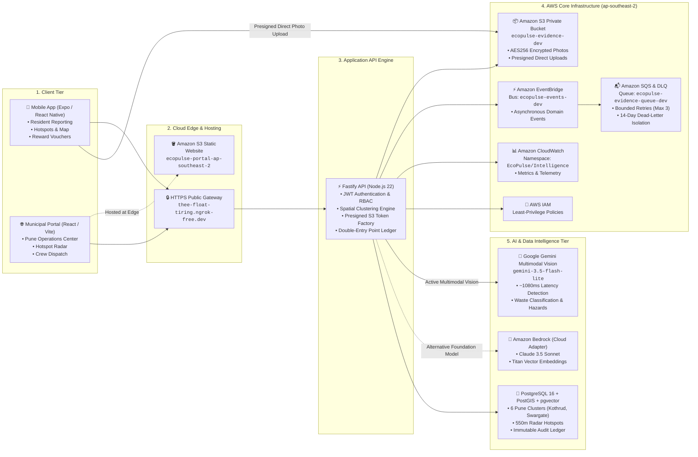
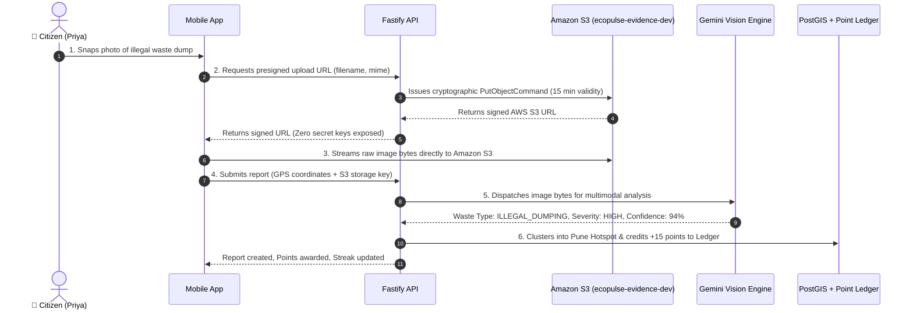
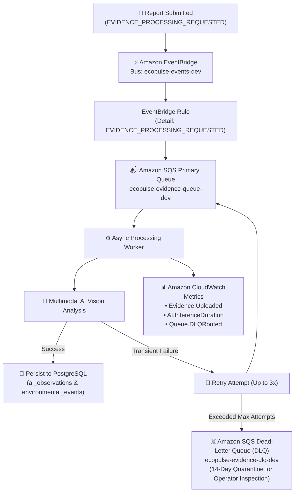

# 🌲 EcoPulse: Enterprise Cloud System Architecture

---

## 1. High-Level Architecture Overview

EcoPulse is an event-driven, AI-powered municipal environmental intelligence platform combining citizen participation, spatial analytics, and cloud orchestration.

---

## 2. Ingestion & Storage Pipeline (Zero Credential Leakage)

---

## 3. Event-Driven Asynchronous Pipeline (EventBridge + SQS DLQ)

---

## 4. Municipal Operations & Hotspot Clustering

```mermaid
flowchart LR
  subgraph CitizenReports["Citizen Reports"]
    R1["Report 1: Kothrud (18.5074, 73.8077)"]
    R2["Report 2: Deccan (18.5150, 73.8410)"]
    R3["Report 3: Swargate (18.4988, 73.8570)"]
  end

  subgraph SpatialClustering["PostGIS Spatial Clustering Engine"]
    BBOX["Spatial Bounding Box & Ray Casting"]
    Radius["550-meter Proximity Evaluation"]
    Clustering["Neighborhood Density Weighting"]
  end

  subgraph PuneClusters["6 Pune Municipal Clusters"]
    C1["🔴 Kothrud Cluster (Active Radar)"]
    C2["🔴 Shivaji Nagar Cluster"]
    C3["🔴 Swargate Cluster"]
    C4["🔴 Hadapsar Cluster"]
    C5["🔴 Viman Nagar Cluster"]
    C6["🔴 Katraj Cluster"]
  end

  subgraph Interventions["Municipal Operations"]
    AdminPortal["🌐 AWS S3 Operations Portal"]
    Dispatch["👷 Dispatch PMC Sanitation Crew"]
    Resolution["✅ Mark Cleanup Complete (Before/After)"]
  end

  CitizenReports --> SpatialClustering
  SpatialClustering --> PuneClusters
  PuneClusters --> AdminPortal
  AdminPortal --> Dispatch --> Resolution
```

---

## 5. AWS Services Inventory

| # | AWS Service | Resource Name / Identifier | Purpose & Architecture Role |
| :---: | :--- | :--- | :--- |
| **1** | **Amazon S3 (Web Hosting)** | `ecopulse-portal-ap-southeast-2` | Hosts the static production municipal web portal at `http://ecopulse-portal-ap-southeast-2.s3-website-ap-southeast-2.amazonaws.com`. |
| **2** | **Amazon S3 (Evidence Storage)** | `ecopulse-evidence-dev` | Private encrypted storage for citizen evidence photos, drone scans, and audit documents. |
| **3** | **Amazon S3 (Presigned URLs)** | `@aws-sdk/s3-request-presigner` | Cryptographic presigned URL factory allowing mobile clients to upload directly to S3 without AWS credentials. |
| **4** | **Amazon EventBridge** | `ecopulse-events-dev` | Custom serverless event bus routing domain events (`REPORT_CREATED`, `EVIDENCE_PROCESSING_REQUESTED`). |
| **5** | **Amazon SQS** | `ecopulse-evidence-queue-dev` | Message queue buffering evidence processing jobs with long-polling and bounded retry policies. |
| **6** | **Amazon SQS (DLQ)** | `ecopulse-evidence-dlq-dev` | Dead-letter queue isolating poisoned or corrupted uploads after 3 failed retries. |
| **7** | **Amazon CloudWatch** | Namespace: `EcoPulse/Intelligence` | Captures operational metrics (`Evidence.Uploaded`, `AI.InferenceDuration`, `Queue.DLQRouted`) with 7-day log retention. |
| **8** | **AWS IAM** | User: `ecopulse-s3-user` Account: `730012679620` | Identity-based least-privilege security access control. |
| **9** | **Amazon Bedrock (Adapter)** | `anthropic.claude-3-5-sonnet` / `amazon.nova-lite-v1:0` | Multimodal foundation model adapter and Titan embedding provider (`amazon.titan-embed-text-v1`). |
