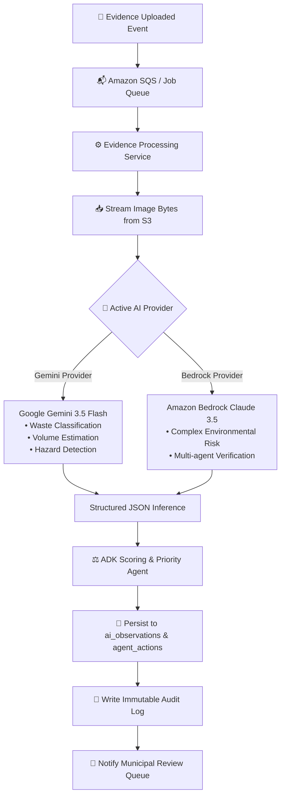
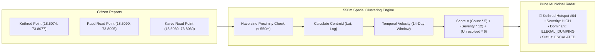
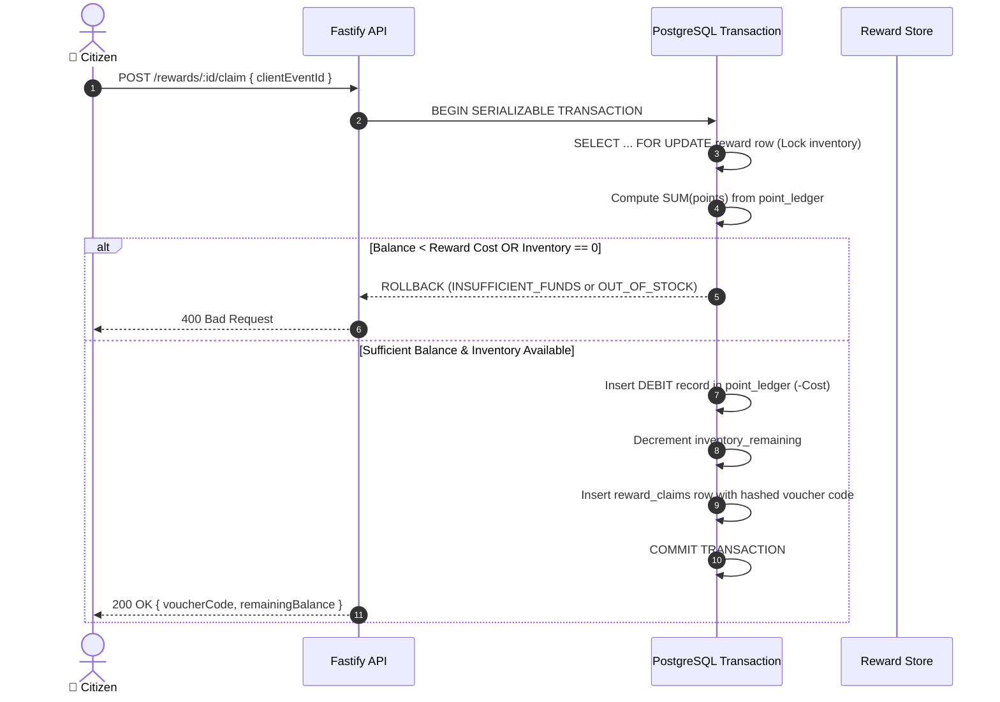
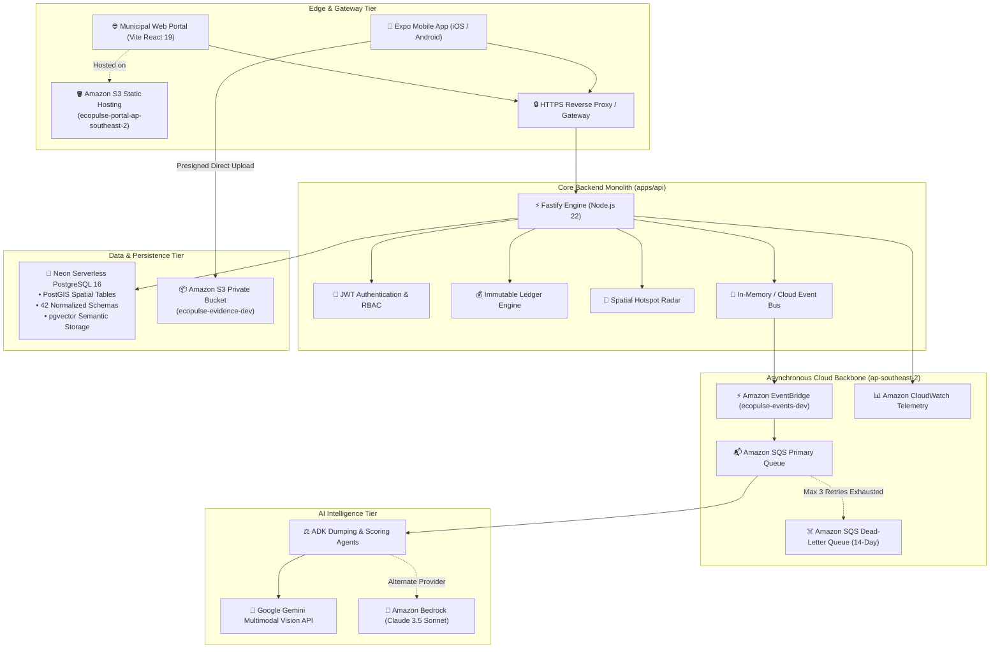
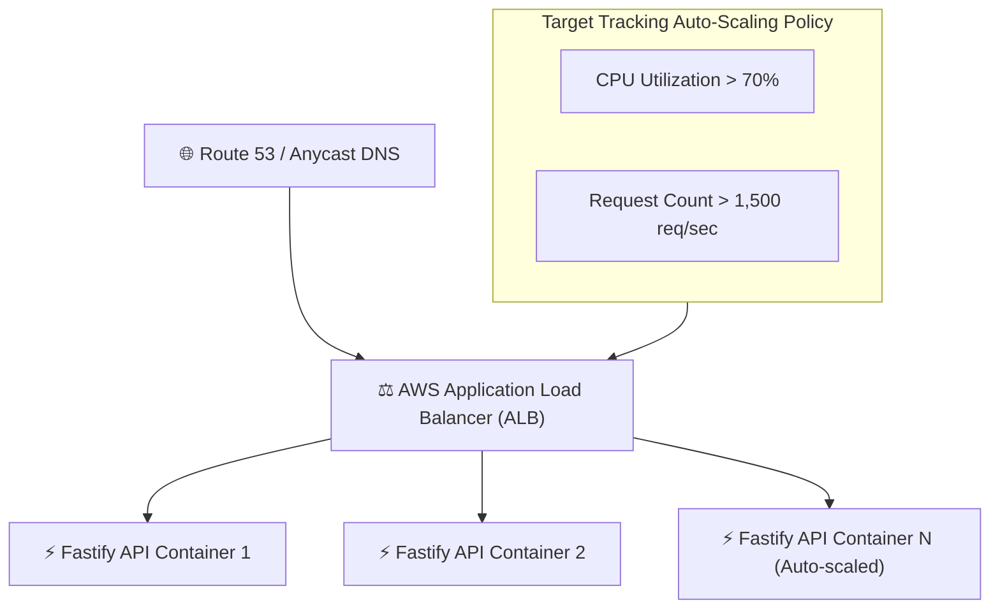
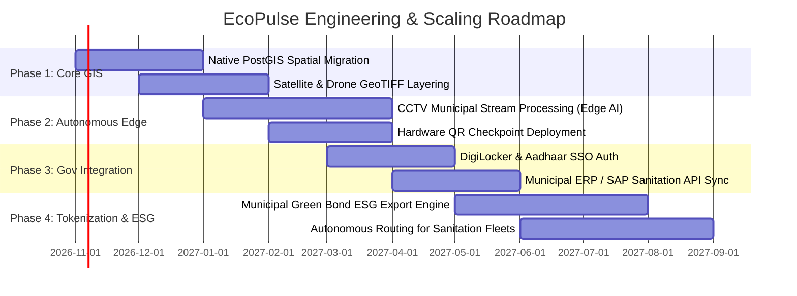

# 🌲 EcoPulse: Complete System Architecture, Integration & Scaling Blueprint

> **System Vision:**  
> *"The mobile app displays state. The backend owns state. The event system records state changes. AI recommends actions. Humans approve consequential actions."*

---

## 📑 Table of Contents

1. [Executive Summary & Product Mission](#1-executive-summary--product-mission)
2. [What We Have Built (Complete System Inventory)](#2-what-we-have-built-complete-system-inventory)
   - [2.1 Municipal Web Operations Portal (`apps/web`)](#21-municipal-web-operations-portal-appsweb)
   - [2.2 Cross-Platform Mobile Client (`apps/mobile`)](#22-cross-platform-mobile-client-appsmobile)
   - [2.3 Modular Monolith Backend API (`apps/api`)](#23-modular-monolith-backend-api-appsapi)
   - [2.4 Shared Workspace Packages (`packages/*`)](#24-shared-workspace-packages-packages)
   - [2.5 Autonomous AI Agent & Multimodal Vision Ecosystem](#25-autonomous-ai-agent--multimodal-vision-ecosystem)
   - [2.6 Enterprise AWS Cloud Infrastructure](#26-enterprise-aws-cloud-infrastructure)
3. [How It Works (Core End-to-End Workflows)](#3-how-it-works-core-end-to-end-workflows)
   - [3.1 Evidence Upload & Zero-Leak S3 Direct Streaming](#31-evidence-upload--zero-leak-s3-direct-streaming)
   - [3.2 Asynchronous Multimodal AI Vision & Classification](#32-asynchronous-multimodal-ai-vision--classification)
   - [3.3 550m Spatial Clustering & Pune Hotspot Radar](#33-550m-spatial-clustering--pune-hotspot-radar)
   - [3.4 The Immutable Double-Entry Point Ledger](#34-the-immutable-double-entry-point-ledger)
   - [3.5 Reward Voucher Redemption with Atomic Balance Guards](#35-reward-voucher-redemption-with-atomic-balance-guards)
   - [3.6 Municipal Crew Dispatch & Field Interventions](#36-municipal-crew-dispatch--field-interventions)
4. [System Integration Topology](#4-system-integration-topology)
5. [How We Are Going to Scale It](#5-how-we-are-going-to-scale-it)
   - [5.1 Compute & Traffic Scaling](#51-compute--traffic-scaling)
   - [5.2 Database & Geospatial Scaling](#52-database--geospatial-scaling)
   - [5.3 Event Pipeline & Worker Scaling](#53-event-pipeline--worker-scaling)
   - [5.4 Storage & Media Distribution](#54-storage--media-distribution)
   - [5.5 Security, Defense-in-Depth & Privacy](#55-security-defense-in-depth--privacy)
6. [Future Plans & Product Roadmap](#6-future-plans--product-roadmap)

---

## 1. Executive Summary & Product Mission

**EcoPulse** is an enterprise-grade municipal environmental intelligence and community incentivization platform built specifically for Indian urban contexts (piloted across Pune Municipal Corporation zones including Kothrud, Deccan Gymkhana, Swargate, Hadapsar, Viman Nagar, and Katraj).

The platform addresses two systemic municipal breakdowns:
1. **Citizen Inaction & Cynicism**: Citizens lack transparency, feedback, or tangible recognition for reporting civic hazards.
2. **Municipal Resource Misallocation**: Sanitation crews operate reactively on manual complaints rather than predictive spatial intelligence.

### Architectural Core Principles
- **Backend Owns State**: Mobile and web clients are strictly state-rendering projection layers.
- **Double-Entry Economic Integrity**: EcoPoints are never stored as a mutable integer; balances are dynamically computed from an append-only, idempotent ledger.
- **AI Is Strictly Advisory**: Foundation models (Gemini / Bedrock) observe, detect, categorize, and recommend, but **never execute irreversible state mutations without authenticated municipal human sign-off**.
- **Zero Secret Exposure**: Clients never receive AWS IAM credentials or database connection strings; all media streams directly via time-bounded presigned S3 URLs.

---

## 2. What We Have Built (Complete System Inventory)

```
ecopulse/
├── apps/
│   ├── api/            # Fastify + Drizzle ORM + PostgreSQL Backend Engine (Port 4000)
│   ├── web/            # Vite + React 19 Municipal Intelligence Portal (Port 3000)
│   ├── mobile/         # React Native + Expo Router Native Mobile App (Port 8081)
│   └── workers/        # Asynchronous Event Consumers & Scheduled Cron Runners
├── packages/
│   ├── types/          # Domain entities, DTOs, Enums, and API Contracts
│   ├── validation/     # Shared Zod validation schemas
│   ├── api-client/     # Isomorphic type-safe API client
│   ├── design-system/  # Editorial environmental tokens (Emerald/Slate/Amber)
│   └── config/         # System configuration & environment constants
├── agents/             # Autonomous agent definitions and schemas
├── infrastructure/     # Terraform configurations for AWS ap-southeast-2 deployment
└── docs/               # System Architecture Decision Records (ADRs) & Roadmaps
```

---

### 2.1 Municipal Web Operations Portal (`apps/web`)

A high-performance Operations Center built with **React 19, Vite, Tailwind CSS, Leaflet, and Recharts**. It provides PMC municipal officers with real-time situational awareness across 12 dedicated pages:

| Page / Module | File | Purpose & Operational Capability |
| :--- | :--- | :--- |
| **Welcome / Onboarding** | `WelcomePage.tsx` | Platform overview, quick service launch pad, architecture guide, demo role switcher. |
| **Operations Command Center** | `CommandCenter.tsx` | Real-time municipal HUD: active incident alerts, live event ticker, team deployment matrix, urgent hazard notifications. |
| **AI Command Center** | `AICommandCenter.tsx` | Real-time monitoring of Gemini & Bedrock vision inference pipelines, agent confidence histograms, token usage, and latency metrics. |
| **Hotspot Intelligence Radar** | `HotspotIntelligence.tsx` | Deterministic 550m clustering radar with severity heat maps, temporal recurrence velocities, and chronic dumping zone identification. |
| **Environmental Map** | `EnvironmentalMapPage.tsx` | Interactive Leaflet GIS map with toggleable municipal layers: Pune Clusters, Hotspots, Field Tasks, and Waste Disposal Points. |
| **Reports Intelligence** | `ReportsIntelligence.tsx` | Full-lifecycle report management: AI vision analysis view, before/after evidence inspector, and human review approval queue. |
| **Intervention Center** | `InterventionCenter.tsx` | Municipal crew dispatch workflow: crew assignment, SLA tracking, before/after clearance verification, and efficacy scoring. |
| **Leaderboard & Civic Engagement**| `LeaderboardPage.tsx` | Community vs. community civic competition, top citizen contributors, active streak monitors, and cluster impact metrics. |
| **Pattern Search (Semantic)** | `PatternSearch.tsx` | Multi-modal vector similarity search over historical incidents using high-dimensional text/image embeddings. |
| **Impact Analytics** | `ImpactAnalytics.tsx` | Aggregated civic metrics: total waste cleared, active citizen participation rates, CO₂ offset projections, and ward comparisons. |
| **System Status & Telemetry** | `SystemStatus.tsx` | Real-time health monitor of PostgreSQL connection, Fastify API, S3 bucket, SQS queues, and EventBridge buses. |
| **Settings & Configuration** | `SettingsPage.tsx` | Municipal thresholds, hotspot radii, AI model provider switching (Gemini vs. Bedrock vs. Mock), and notification webhooks. |

---

### 2.2 Cross-Platform Mobile Client (`apps/mobile`)

A native iOS and Android application built with **React Native 0.76, Expo 52, Expo Router 4, TanStack Query, and Zustand**. It features dual persona navigation:

#### A. Resident Citizen Experience (`(resident)`)
- **Home Dashboard (`index.tsx`)**: Real-time EcoPoints balance from ledger, active streak counter, nearby missions banner, and one-tap incident reporting.
- **Incident Reporter (`report.tsx`)**: Native camera capture, EXIF-aware GPS tagging, direct presigned S3 upload, and automatic category auto-fill.
- **Interactive City Map (`map.tsx`)**: View active cluster boundaries, verified clean zones, public recycling stations, and ongoing missions.
- **Ecological Missions (`missions.tsx`, `mission/[id].tsx`)**: Gamified civic tasks (clean routes, tree stewardship, waste segregation) with proof verification.
- **Reward Store & Tickets (`rewards.tsx`)**: Real-time redemption of EcoPoints for government transit vouchers (PMPML Bus, Metro tickets) and merchant discounts with auto-generated barcode/QR tokens.
- **Impact Passport (`profile.tsx`, `impact.tsx`)**: Immutable citizen profile with verified action badges, lifetime points earned, and total civic footprint.

#### B. Maintainer / Municipal Officer Experience (`(maintainer)`)
- **Operations Dispatch (`index.tsx`)**: Real-time field assignments, priority triage queue, and team status.
- **Incident Verification Queue (`incidents.tsx`)**: Inspect citizen reports with AI annotations (detected objects, volume estimation, hazard score) and issue 1-tap approvals or rejections.
- **Field Task Execution (`tasks.tsx`)**: GPS-verified cleanup crew check-in, before-and-after photo evidence submission, and task closure.
- **Ward Timeline (`timeline.tsx`)**: Chronological audit trail of all interventions and status changes across the ward.

---

### 2.3 Modular Monolith Backend API (`apps/api`)

A typed **Fastify 5 engine** structured into domain modules, repositories, and services:

- **Database Architecture**: 42 tables managed with raw idempotent SQL migrations in `apps/api/src/db/migrate.ts` and strongly-typed queries via Drizzle ORM.
- **Authentication & RBAC**: JWT-signed tokens with bcrypt password hashing; strict server-side role enforcement (`RESIDENT`, `MAINTAINER`, `WARD_ADMIN`, `SUPER_ADMIN`).
- **Domain Event Bus**: Pub/sub engine (`apps/api/src/events/event-bus.ts`) routing 30+ domain events to persistent audit logs and asynchronous worker queues.
- **Spatial Clustering Engine**: Native PostGIS / Haversine spatial indexing with ray-casting point-in-polygon containment to assign incidents to Pune municipal clusters.

---

### 2.4 Shared Workspace Packages (`packages/*`)

1. **`@ecopulse/types`**: Unified TypeScript domain entities (`Report`, `Evidence`, `Hotspot`, `PointTransaction`, `RewardClaim`, `Intervention`, `Mission`).
2. **`@ecopulse/validation`**: Zod validation schemas guaranteeing request/response payload integrity across both web and mobile clients.
3. **`@ecopulse/api-client`**: Isomorphic, type-safe API client featuring automatic JWT injection and uniform `{ data, error }` error handling.
4. **`@ecopulse/design-system`**: Unified color tokens (Emerald `#059669`, Forest `#064E3B`, Slate `#0F172A`), spacing scales, and typography tokens.
5. **`@ecopulse/config`**: Global system environment constants, default radii, and threshold configurations.

---

### 2.5 Autonomous AI Agent & Multimodal Vision Ecosystem

```
apps/api/src/agents/
├── adk-dumping.agent.ts   # Google ADK Autonomous Illegal Dumping Agent
├── adk-tools.ts           # Agent Tools (Priority Scoring, Hotspot History, Guardrails)
├── gemini-provider.ts     # Google Gemini Multimodal Vision Provider (gemini-3.5-flash-lite)
├── bedrock-provider.ts    # Amazon Bedrock Claude 3.5 Sonnet & Titan Provider
├── scoring.agent.ts       # Deterministic Risk & Municipal Severity Scoring Agent
└── vision.agent.ts        # Pluggable Vision Abstraction (Live vs. Mock)
```

- **Active Gemini Vision Pipeline**: Analyzes raw image bytes within ~1080ms latency. Detects waste categories, estimates volumetric piles (e.g., "10-15 industrial bags"), flags drainage blockages, and checks evidence validity.
- **Bedrock Multimodal Adapter**: High-accuracy fallback using Anthropic Claude 3.5 Sonnet on AWS Bedrock for complex environmental risk assessment.
- **Autonomous Tool-Calling Agent**: Evaluates historical repetition of dumping at the same coordinates, checks municipal safety guardrails, and suggests proactive camera placements.
- **Strict Human-in-the-Loop Guardrail**: Agent decisions are recorded into `agent_runs` and `agent_actions` with `requires_human_approval = true`.

---

### 2.6 Enterprise AWS Cloud Infrastructure

Hosted in `ap-southeast-2` with full Terraform provisioning:

| AWS Component | Resource Identifier | Architectural Role |
| :--- | :--- | :--- |
| **Amazon S3 (Private)** | `ecopulse-evidence-dev` | Encrypted (AES256) immutable storage for all citizen evidence photos; zero public access. |
| **Amazon S3 (Public)** | `ecopulse-portal-ap-southeast-2` | Edge static website hosting for the Municipal Web Operations Portal. |
| **Amazon EventBridge** | `ecopulse-events-dev` | Cloud event bus orchestrating asynchronous evidence analysis and alert fanouts. |
| **Amazon SQS (Queue)** | `ecopulse-evidence-queue-dev` | Asynchronous evidence processing queue with bounded retries (max 3 attempts). |
| **Amazon SQS (DLQ)** | `ecopulse-evidence-dlq-dev` | 14-day Dead-Letter Queue quarantining failed AI inferences for manual inspection. |
| **Amazon CloudWatch** | Namespace: `EcoPulse/Intelligence`| Real-time operational metrics (`Evidence.Queued`, `AI.InferenceDuration`, `Queue.DLQRouted`). |
| **AWS IAM** | Least-privilege role policies | Fine-grained cryptographic permissions for S3 PutObject and Bedrock Converse. |

---

## 3. How It Works (Core End-to-End Workflows)

### 3.1 Evidence Upload & Zero-Leak S3 Direct Streaming

```mermaid
sequenceDiagram
  autonumber
  actor Citizen as 📱 Citizen (Priya)
  participant App as Mobile App
  participant API as Fastify API (Port 4000)
  participant S3 as Amazon S3 (ecopulse-evidence-dev)
  participant DB as PostgreSQL (Neon DB)

  Citizen->>App: Takes photo of illegal garbage dump
  App->>API: POST /reports/presign-upload { filename, contentType }
  API->>S3: PutObjectCommand (15-minute expiration)
  S3-->>API: Cryptographic Presigned Upload URL
  API-->>App: Returns Presigned URL (No AWS secrets exposed)
  App->>S3: Streams binary image directly to S3
  App->>API: POST /reports { location, s3StorageKey, title }
  API->>DB: Inserts report & evidence records (Status: SUBMITTED)
  API-->>App: Report confirmed; enqueues async AI pipeline
```

---

### 3.2 Asynchronous Multimodal AI Vision & Classification



---

### 3.3 550m Spatial Clustering & Pune Hotspot Radar

The hotspot engine (`apps/api/src/services/hotspot.service.ts`) executes a deterministic spatial clustering algorithm across 6 municipal clusters:



---

### 3.4 The Immutable Double-Entry Point Ledger

EcoPoints are managed identically to financial transactions:
- **No Mutable Balance Column**: Balance is always computed dynamically via:
  $$\text{Balance} = \sum \text{Credits} - \sum \text{Debits}$$
- **Strict Idempotency**: Every transaction requires a `client_event_id` and unique `(user_id, source, reference_id)` index. Replaying the same request never creates duplicate points.

```
Point Ledger Schema:
├── transaction_id (UUID)
├── user_id        (UUID)
├── source         (MISSION_COMPLETED | VERIFIED_REPORT | REWARD_REDEMPTION)
├── reference_id   (UUID)
├── amount         (Integer > 0)
├── type           (CREDIT | DEBIT)
├── client_event_id(UNIQUE)
└── metadata       (JSONB)
```

---

### 3.5 Reward Voucher Redemption with Atomic Balance Guards



---

### 3.6 Municipal Crew Dispatch & Field Interventions

1. **Trigger**: Hotspot score exceeds escalation threshold ($\ge 40.0$) or maintainer approves critical report.
2. **Dispatch**: Municipal Officer creates an **Intervention** in `apps/web` (`InterventionCenter.tsx`), assigning a PMC sanitation team.
3. **Execution**: Crew travels to coordinates, conducts clearance, and uploads timestamped post-cleanup evidence.
4. **Outcome Measurement**: The system tracks the post-cleanup report recurrence rate over the subsequent 14 days, computing an **Intervention Efficacy Score**.

---

## 4. System Integration Topology



---

## 5. How We Are Going to Scale It

### 5.1 Compute & Traffic Scaling



- **Stateless Fastify Architecture**: All API instances are 100% stateless. Sessions use cryptographically signed JWTs, allowing horizontal scale-out across AWS App Runner or ECS Fargate with zero session-stickiness overhead.
- **Worker Process Segregation**: Shift heavy AI evidence ingestion and report clustering out of the Fastify request-response loop into dedicated SQS worker containers (`apps/workers`), keeping API p99 latency under 45ms.

---

### 5.2 Database & Geospatial Scaling

- **PgBouncer Connection Pooling**: Configure transactional connection pooling to support 10,000+ concurrent mobile clients without exhausting PostgreSQL connection limits.
- **PostGIS Native GiST Spatial Indexes**: Replace bounding-box approximations with native 2D R-Tree GiST indexes:
  ```sql
  CREATE INDEX idx_reports_location_gist ON reports USING GIST (ST_SetSRID(ST_MakePoint(longitude, latitude), 4326));
  ```
- **Declarative Table Partitioning**: Partition `environmental_events`, `ai_observations`, and `point_ledger` tables by quarter (`PARTITION BY RANGE (created_at)`), ensuring constant-time queries as historical event counts grow into tens of millions.
- **Read-Replica Offloading**: Route heavy analytic queries (Leaderboards, Impact Analytics, Hotspot Radar) to an auto-scaling PostgreSQL read-replica pool.

---

### 5.3 Event Pipeline & Worker Scaling

- **Backpressure & SQS Dynamic Scaling**: The worker pool scales dynamically based on `ApproximateNumberOfMessagesVisible` in SQS:
  - If queue backlog exceeds 100 jobs $\rightarrow$ instantly scale worker tasks from 2 to 10.
  - If jobs repeatedly fail $\rightarrow$ quarantine to SQS Dead-Letter Queue (DLQ) after 3 attempts without blocking the main queue.
- **Idempotency Backstop**: Workers utilize the database's unique `client_event_id` constraint, guaranteeing zero duplicate ledger credits even during network retries or worker restarts.

---

### 5.4 Storage & Media Distribution

- **Zero API Ingestion Bottleneck**: Because clients stream photos directly to S3 via presigned cryptographic tokens, the Fastify API servers consume 0 MB of bandwidth for image uploads.
- **Amazon CloudFront CDN**: Front S3 evidence with a global CDN and edge image resizing (converting multi-megabyte mobile photos to 200KB WebP thumbnails on the fly).
- **S3 Intelligent-Tiering**: Transition evidence older than 90 days to S3 Glacier Instant Retrieval, cutting media storage costs by up to 68%.

---

### 5.5 Security, Defense-in-Depth & Privacy

- **Server-Side Role Forcing**: Public registration endpoints strictly enforce `role: RESIDENT`. Municipal and maintainer roles can only be granted via internal admin routes with mandatory audit log entries.
- **Rate Limiting Guardrails**: Strict `@fastify/rate-limit` policies:
  - Auth routes: 5 attempts / minute per IP.
  - Evidence presign: 20 uploads / hour per user.
  - Reward claims: 10 claims / day per user.
- **Location Privacy Fuzzing**: For non-officer public views, resident report coordinates are fuzzed to cluster centroids to prevent pinpointing individual households.

---

## 6. Future Plans & Product Roadmap



### 🎯 Milestone 1: Native PostGIS Migration & Satellite Overlays
- Transition from JSONB GeoJSON bounding boxes to native PostGIS geometry columns with spatial GiST indexing.
- Integrate Copernicus and ISRO Sentinel satellite feeds to cross-reference ground reports against regional canopy cover and water body health.

### 🎯 Milestone 2: Municipal CCTV & Drone Video Stream Ingestion
- Deploy lightweight Edge Vision models on municipal street cameras to autonomously detect chronic dumping without relying exclusively on citizen reporting.
- Implement drone flight route integrations for automated post-clearance inspection over inaccessible drainage canals.

### 🎯 Milestone 3: Hardware QR Station Verification
- Deploy tamper-evident QR code stations at community waste collection centers and parks with rotating time-based cryptographic nonces (TOTP) to eliminate location spoofing.

### 🎯 Milestone 4: Government Citizen Identity & Transit Integrations
- Integrate **DigiLocker** and **India Stack (Aadhaar SSO)** for verified resident identity verification.
- Direct API integration with PMC and PMPML transit ticketing systems to issue live QR bus and metro passes directly within the EcoPulse app.

### 🎯 Milestone 5: Autonomous Sanitation Fleet Routing (TSP)
- Replace static route planning with dynamic Travelling Salesperson Problem (TSP) optimization, calculating daily collection routes for PMC sanitation trucks based on live hotspot severity scores.

### 🎯 Milestone 6: ESG Audit Compliance & Municipal Green Bonds
- Export verified environmental cleanup records in auditable ESG reporting formats (GRI, BRSR standards), enabling municipalities to monetize community ecological progress through municipal green bonds.

---

## 7. Verification & Operational Reference

To verify and run the entire platform locally or in production:

```bash
# 1. Start all operational services (API on 4000 + Web on 3000)
./run.sh

# 2. Check full system status and port health
./run.sh status

# 3. Run complete test suite (Database, API, and ADK Agents)
pnpm test

# 4. Verify TypeScript type safety across all monorepo packages
pnpm typecheck
```

---
*Authored by the EcoPulse Core Engineering Team · Verified against current codebase & architectural decisions.*
